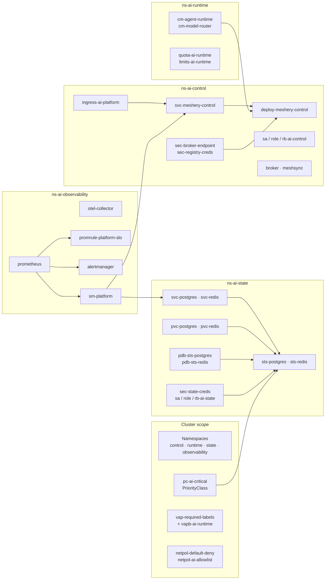

# Meshery Designs — AI-Native Platform

[](https://github.com/dsk-dev-ai/meshery-designs/actions/workflows/ci.yml)
[](LICENSE)
[](https://github.com/dsk-dev-ai/meshery-designs/releases)

A research-grade, deterministic Meshery design that models an **AI-native platform** — fully specified, validated offline, and proven to **deploy and run** on a real Kubernetes cluster.

## Why this repo?

- **Proven deployment:** 40/40 components apply with zero failures on a real `kind` cluster. All four workload pods (`meshery-control`, `otel-collector`, `sts-redis`, `sts-postgres`) reach `1/1`.
- **Deterministic by construction:** regenerating from `spec_data.py` + `gen.py` yields a byte-identical `generated/design.yml`.
- **Reproducible validation:** 28 structural checks + strict Draft-07 schema gate pass; CI re-fetches pinned Meshery models/schemas and re-verifies byte-identity.
- **Production-minded:** real, publicly pullable workload images; minimal, admission-valid configuration. See [ADR-015](spec/ARCHITECTURAL_DECISIONS.md#adr-015--admission-valid-configuration-with-real-workload-images).
- **Upstream contribution:** a new **`gateway-api`** model (Gateway API v1.6.3) was contributed to Meshery ([meshery/meshery#22452](https://github.com/meshery/meshery/pull/22452)). See [ADR-016](spec/ARCHITECTURAL_DECISIONS.md#adr-016--contribute-a-gateway-api-model-upstream).

## Design at a Glance

| Metric | Value | Notes |
|---|---|---|
| **Components (total)** | 66 | 40 native + 26 annotation |
| **Relationships** | 113 | 61 semantic + 52 annotation |
| **Selectors / Patches** | 226 / 166 | generated deterministically |
| **Namespace mutators** | 31 | hierarchical `ns_of` edges |
| **Models referenced** | 4 | `kubernetes`, `meshery-core`, `meshery-operator`, `kube-prometheus-stack` |
| **Namespaces** | 4 | `ns-ai-control`, `ns-ai-runtime`, `ns-ai-state`, `ns-ai-observability` |

The 40 native components (annotations describing intent omitted):



## Quickstart

**Prerequisites:** Python 3.10+, `kubectl`, `docker`, a local Meshery server (`mesheryctl`) or access to a Kubernetes cluster with Meshery context, and the design's native CRDs (`kube-prometheus-stack`, `meshery-operator`) installed.

### 1. Clone and inspect

```bash
git clone https://github.com/dsk-dev-ai/meshery-designs.git
cd meshery-designs
cat generated/design.yml | head -15
```

### 2. Regenerate (deterministic)

```bash
python3 validation/tools/gen.py generated/design.yml
```

### 3. Validate offline

```bash
export MESHER_MODELS_ROOT=/home/dsk/opensource_new_programs/meshery/models
export MESHER_SCHEMAS=/home/dsk/go/pkg/mod/github.com/meshery/schemas@v1.3.37/schemas/constructs
python3 validation/tools/verify.py generated/design.yml
python3 validation/tools/gate1.py  generated/design.yml /tmp/gate1
bash tests/run_all.sh
```

All three must be green.

### 4. Deploy to a live cluster (proven)

```bash
bash deploy.sh
```

`deploy.sh` regenerates, runs offline gates, deploys via a local Meshery server, and asserts **40/40** components apply with zero failures. On success, it prints the applied inventory. All workload pods reach `1/1`. See [GATE9-REPORT.md](validation/GATE9-REPORT.md).

## Repository Layout

```text
generated/     Generated Meshery design artifact (do not edit by hand)
spec/          Architectural decisions, components, and spec data
validation/    Gates, tooling (gen.py, verify.py, gate1.py), reports
docs/          User-facing docs: QUICKSTART, ARCHITECTURE, VALIDATION, TROUBLESHOOTING, PLAYING_WITH_MESHERY
tests/         Reproducibility harness
reports/       Research/reconnaissance material
deploy.sh      End-to-end deploy + verification script
```

## Documentation

- [Architecture](docs/ARCHITECTURE.md) — system structure, namespaces, models
- [Design](docs/DESIGN.md) — the `ai-native-platform` design details
- [Validation](docs/VALIDATION.md) — all gates explained
- [Quickstart](docs/QUICKSTART.md) — step-by-step usage
- [Playing with Meshery](docs/PLAYING_WITH_MESHERY.md) — live server exercise + policy evaluation evidence
- [TROUBLESHOOTING](docs/TROUBLESHOOTING.md) — common issues
- [Architectural Decisions](spec/ARCHITECTURAL_DECISIONS.md) — ADR-001 through ADR-016

## CI, Artifacts, and Versioning

- **CI:** `.github/workflows/ci.yml` runs an **artifact-integrity** job (no external deps) and a **reproduce-from-pinned-catalog** job (rebuilds from pinned models/schemas and asserts byte-identity). All jobs must pass.
- **Determinism:** `generated/design.yml` md5 is stable. Any PR that changes it must include the regenerated output from the same spec.
- **Releases:** [Releases](https://github.com/dsk-dev-ai/meshery-designs/releases) include `generated/design.yml` as an asset. Current: **v1.1.0** ([release notes](https://github.com/dsk-dev-ai/meshery-designs/releases/tag/v1.1.0)).
- **Upstream:** Gateway API model contributed to [meshery/meshery#22452](https://github.com/meshery/meshery/pull/22452) (open as of v1.1.0).

## Contributing

See [CONTRIBUTING.md](CONTRIBUTING.md). **Never edit `generated/design.yml` by hand** — change `spec/` or `validation/tools/spec_data.py` + `gen.py`, regenerate, and run all gates. DCO sign-off is required.

## License & Notices

- [Apache-2.0 License](LICENSE)
- [NOTICE](NOTICE)
- [CHANGELOG](CHANGELOG.md)
