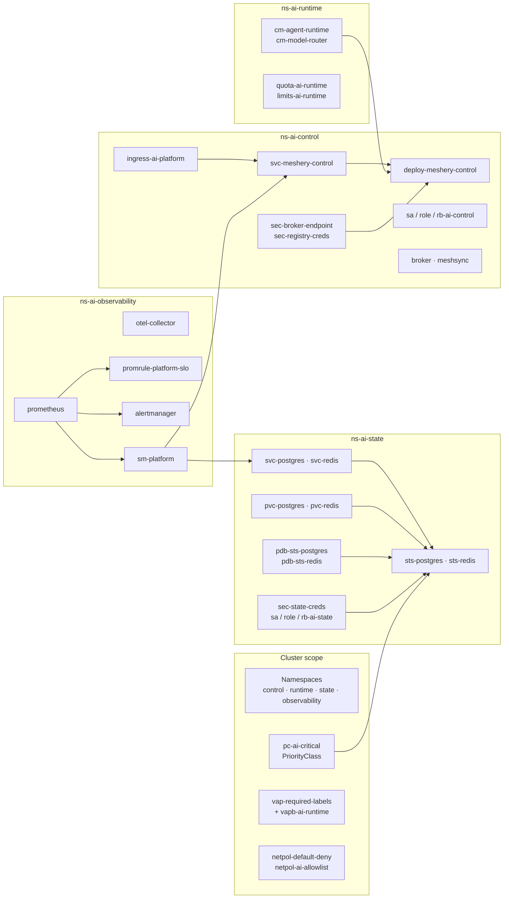

# Meshery Designs — AI-Native Platform

[](https://github.com/dsk-dev-ai/meshery-designs/actions/workflows/ci.yml)
[](LICENSE)
[](https://github.com/dsk-dev-ai/meshery-designs/releases)

Research, architecture, generation, and validation of an AI-native
platform design for Meshery.

## Project

This repository contains the `ai-native-platform` Meshery design,
the architectural research behind it, a deterministic generator,
and reproducible validation reports.

The repository is independent from the upstream Meshery source
repositories.

## Design

The current design contains:

- 66 components
- 40 native components
- 26 annotation components
- 113 relationships
- 226 selector entries
- 166 patch entries
- 31 namespace mutator relationships
- 4 referenced models (`kubernetes`, `meshery-core`, `meshery-operator`, `kube-prometheus-stack`)

The design uses four namespaces:

- `ns-ai-control`
- `ns-ai-runtime`
- `ns-ai-state`
- `ns-ai-observability`

### Design at a glance

The 40 native components and their semantic edges (the 26 `meshery-core` annotation components that
describe intent are omitted):



## Repository Structure

```text
generated/     Generated Meshery design artifact
spec/          Architecture, components, relationships and decisions
reports/       Research and reconnaissance
validation/    Validation gates and reproducible tooling
docs/          User-facing documentation
tests/         Reproducibility and harness tests
```

## Tests

Run the comprehensive validation tests:

```bash
bash tests/run_all.sh
```

Or run individual tests:

```bash
for f in tests/test_*.py; do python3 $f; done
```

## Deploy

The design deploys to a live Kubernetes cluster: **40/40 components apply with zero failures** on a
`kind` cluster running the design's native CRDs. See `validation/GATE9-REPORT.md` for the evidence.

```bash
bash deploy.sh
```

`deploy.sh` regenerates the artifact, runs every offline gate, deploys through a local Meshery
server, and asserts the 40/40 result. `docs/QUICKSTART.md` walks through the same flow.

> Each workload uses the real, publicly pullable image for its role (Meshery, the OpenTelemetry
> Collector, Redis, PostgreSQL), so the stack **runs**, not just applies. Sizing and policy values
> (ports, PVC storage, the Postgres password, alert thresholds) are overridden for production. See
> ADR-015.

## Continuous integration

CI (`.github/workflows/ci.yml`) runs two jobs: an **artifact integrity** job that checks the
committed design with no external dependencies, and a **reproduce** job that fetches the pinned
Meshery catalog and schemas, regenerates the artifact, and asserts it is byte-identical before
running the structural and schema gates.

## Playing with Meshery

`docs/PLAYING_WITH_MESHERY.md` walks through exercising the design against a **live Meshery
server**: registering models and running the design through the server-side relationship/policy
evaluation engine. It records the evidence and the API findings (see ADR-016).

## Upstream contribution

This project contributed a new **`gateway-api`** model (Gateway API v1.6.3 components: `Gateway`,
`GatewayClass`, `HTTPRoute`, `GRPCRoute`, `ReferenceGrant`, `BackendTLSPolicy`) upstream to Meshery
— [meshery/meshery#22452](https://github.com/meshery/meshery/pull/22452). See ADR-016.

## Contributing

See `CONTRIBUTING.md`. Never edit `generated/design.yml` by hand — change `spec_data.py` or `gen.py`
and regenerate.

## License

Apache-2.0. See `LICENSE` and `NOTICE`. Change history is in `CHANGELOG.md`.
